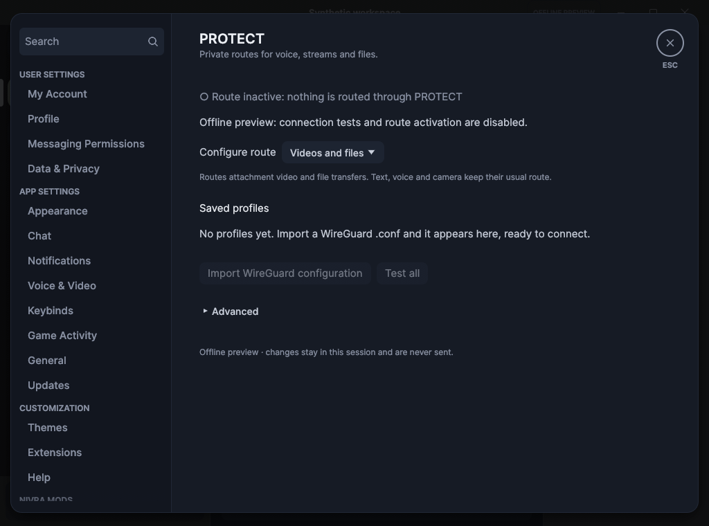
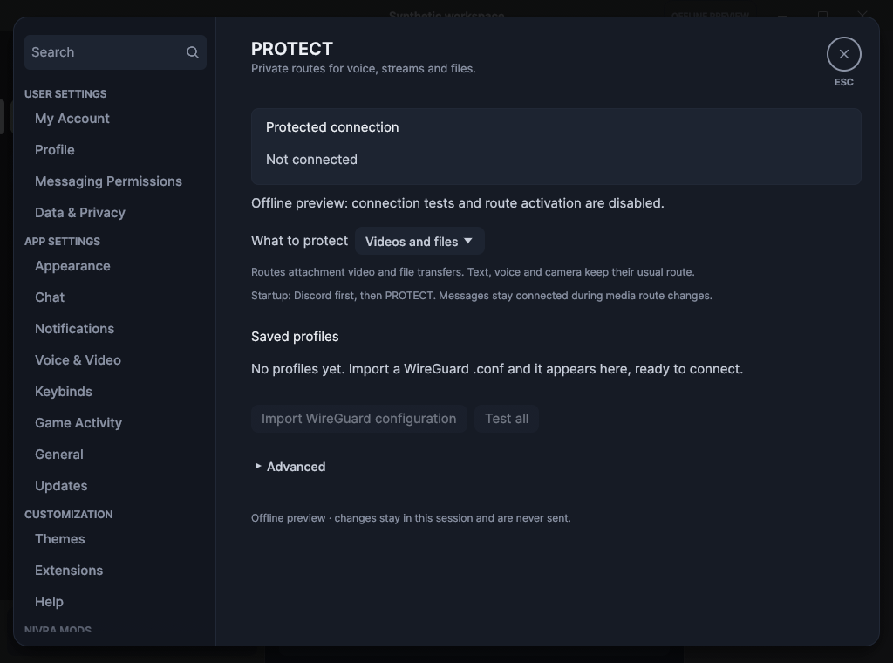

# Scoped PROTECT and bounded audio recovery — October 28, 2026

This is development evidence, **not a published Nivra 1.0.21 release**. The strict
security gate remains red for crypto-bigint. Existing audit exceptions are
unchanged; no new advisory ignore was added.

## Source and commands

- Baseline: `95f7e393b5941168b3d6efc7d8d1c0872938ff36` (application source still based on `93ecdb6b`).
- Tested candidate: `76c05c552ee3f0877aa0a4a90db8522e8e137c97`. Integration adds documentation only to that tree.
- [Windows audit run](https://github.com/vitorhubdev/Nivra/actions/runs/40649493147).
- Rust 1.98.1, `windows-latest`, offline fixtures, native DX12 screenshots.
- No real Discord account, microphone, camera, provider credential or conversation.

| Check | Observed result |
| --- | --- |
| Workspace/fuzz formatting and diff check | Passed |
| `cargo clippy --workspace --all-targets --locked -- -D warnings` | Passed |
| `cargo nextest run --workspace --locked --profile ci` | 1,885 passed; 30 skipped; no failures |
| Workspace doctests, production feature check, `cargo xtask policy` | Passed |
| `node tests/login-handoff.cjs` | Passed |
| Offline `discord-voice` stream_playback example | Passed volume/mute/backlog, RTP reordering/RTX and SSRC replacement |
| Dependency licenses, root and fuzz workspaces | Passed |
| Strict root dependency audit | Failed: crypto-bigint 0.5.5, RUSTSEC-2026-0387 |
| Strict fuzz dependency audit | Passed |

The stream_playback example's hardware decode block is macOS-only and did **not**
run in this Windows job, despite its generic final message. Screenshots prove
native rendering of the fixture, not interactive usability, GPU efficiency or
live audiovisual compatibility. The 30 skipped tests remain skipped, not passed.
The later standard cross-platform CI is separate evidence and is not covered by
this Windows result.

## Reviewed native screenshots

All captures used `profile_preview --demo`; the profile list is intentionally
empty and no network operations are enabled. Dark before/after share the same
1024 x 760 captured viewport (the example clamps the requested width of 1120). The light view is 840 x 760. Text is English in this fixture;
the affected interface strings also have Portuguese and Spanish translations.

| Before | After |
| --- | --- |
|  |  |

[Light/narrow PROTECT](after-protect-light.png) · [Voice settings, top section](after-voice.png).
The voice capture shows the top settings section, not the new local queue metrics.
Reviewed: status hierarchy, scope explanation, empty-profile instructions,
advanced disclosure, control labels and visible overflow in these fixture states.
Populated long-name profiles, actual pre-login interaction, device changes and
keyboard/screen-reader operation still require an interactive owner test.

## Offline queue comparison

Both runs compile the real `capture.rs` as a standalone optimized Rust module,
using 960-sample/20-ms frames and the same driver. One deterministic run per
revision; this is queue behavior, not a noisy CPU-time benchmark.

```text
Before: normal_frames=100, burst_tick_and_frame_id=[(1, 0), (2, 1), (3, 2), (4, 3), (5, 4), (6, 5), (7, 6), (8, 7)]
After:  normal_frames=100, burst_tick_and_frame_id=[(0, 6), (1, 7)]
```

[Machine-readable comparison](queue-comparison.json).
A normal two-frame callback batch preserves all 100 frame IDs in order on both
versions. An eight-frame backlog now keeps the newest two frames instead of
sending all older speech first. Six discarded frames correspond to 120 ms of
queued audio, **not** a measured 120-ms improvement in network or end-to-end latency.
Dropping old speech can omit syllables during a stall; this is a bounded catch-up
tradeoff, not time stretching or packet recovery.

The output queue separately trims above four frames to two and applies a 5-ms
transition ramp. Ordinary small batches stay ordered. Tests cover mute/PTT
isolation, silence priming, stale denoiser epochs and local queue counters. Native
idle CPU, RSS, p95 frame time, complete package size and real-call A/V sync were
not measured in this audit; no percentage improvement is claimed.

## User-visible behavior and boundaries

Partial modes wait for Discord READY before restoring PROTECT. Complete waits for
PROTECT and does not silently permit a direct login after an error or timeout.
Changing a partial route retires only affected media sockets. Explicit Stop,
leaving the call, revoked permission or server-side termination cancels stream
recovery. The Linux portal picker is never reopened automatically, and Complete
account replacement does not retain outgoing/watch intentions.

Saved profiles survive migration, but the old startup marker requires selecting
a saved profile once. Applied configuration and the last edited/tested draft are
now separate. Credential-store writes remain bounded and off the drawing thread.

The documentation details the actual limits in [PROTECT](../../protect.md),
[voice](../../voice.md), [performance](../../performance.md) and
[security](../../../SECURITY.md). No release tag or public executable was created
by this audit.
